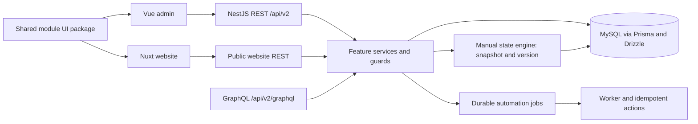
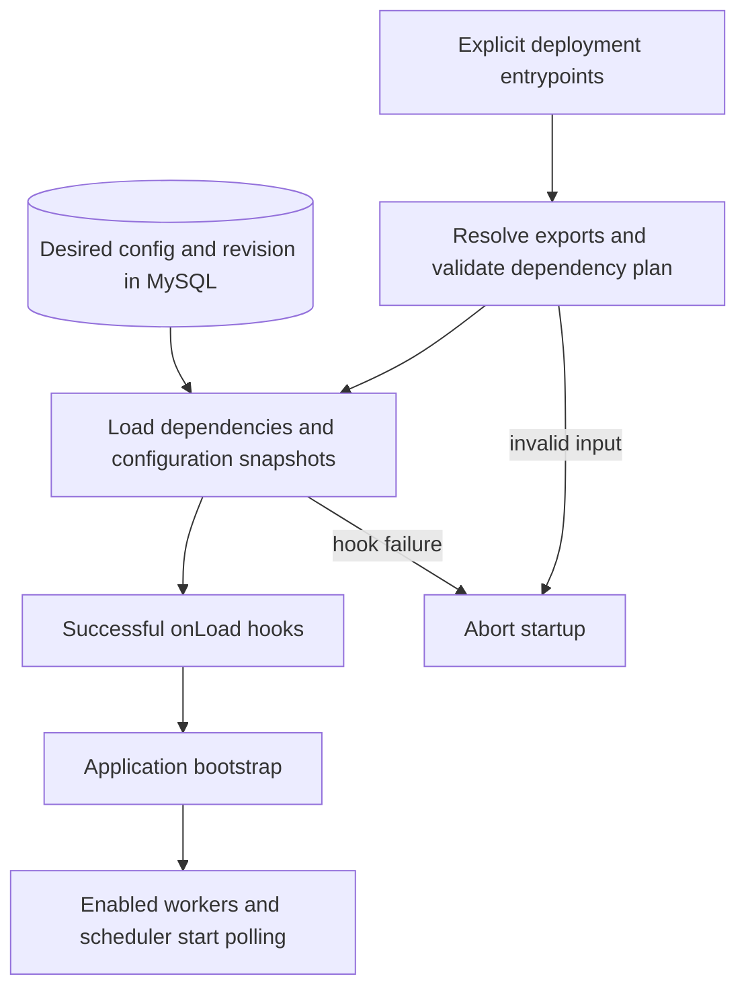

# Current architecture

Updated 2026-10-27. This describes the implemented ownership boundaries, not a
claim that all Express behavior has migrated. [Open tasks](nestjs-migration-tasks.txt)
are the source of truth for unfinished work.

## Source layout

| Location | Responsibility |
|---|---|
| `apps/api/src/core` | Database, permissions, runtime metadata, events, workflows and shared infrastructure |
| `apps/api/src/modules/<feature>` | Nest modules, REST controllers, DTOs, services and feature persistence |
| `apps/api/src/graphql` | GraphQL context, guards, transport adapters and schema |
| `apps/api/prisma` | Canonical active Prisma schema |
| `apps/api/migrations` | Ordered SQL migrations and runner |
| `apps/api/test` | Unit, HTTP and GraphQL integration regressions |
| `apps/api/deploy` | Service templates and operations |
| `packages/@lume/module-ui/src/modules/<feature>/static` | Shared Vue components, widgets, styles and browser API adapters |
| `apps/admin`, `apps/website` | Admin and public application shells |

All applications are direct workspace packages using the root pnpm lockfile.
`legacy/express`, `legacy/frontend`, the obsolete root Nuxt server and old tooling
are retained outside the workspace for feature comparison. Shared UI symlinks in
legacy modules preserve reference paths. Active apps do not import legacy code.
The service definition now uses `apps/api`; no further backend folder move is planned.
NestJS uses `@nestjs/platform-express`; its HTTP adapter is separate from the old
standalone Express application being retired.

## Runtime initialization and configuration

RuntimeModule registers ModuleInitializerService. It imports only explicit
deployment-owned CommonJS entrypoints from `MODULE_ENTRYPOINTS`, optionally adds
examples, validates the batch and calls the dependency-aware loader. Required
entry/import/hook failures abort application initialization. Worker and scheduler
polling starts at application bootstrap after successful module initialization.
This discovers runtime definitions, not Nest service providers or marketplace
packages; database catalog rows never select executable code. Import-time/hook
side effects are not rolled back on startup failure.

Opt-in runtime modules declare configuration defaults, validation and an `onLoad`
consumer. `ModuleConfigurationService` persists desired JSON with optimistic
revisions in `runtime_module_configs` (migration 023). `ModuleLoaderService` tracks
the applied revision locally and applies a validated snapshot at load or through
an explicit `onReload` hook. Catalogs expose both revisions and pending status.
Reload uses lifecycle concurrency guards, does not replace source code, and is
not broadcast across processes. Hook authors must preserve prior state on failure;
the framework advances applied state only after success. Builtins remain managed
by deployment, and saved configuration survives runtime uninstall.

## Tenant ownership boundaries

Tenant registry rows are keyed by existing numeric company IDs and managed by
`TenantRegistryService` through the enterprise GraphQL grid. Migration 022 adds
the registry without inferring ownership or altering company-scoped rows. User
metadata still supplies company assignment at token issuance. Passport checks the
effective company against the registry on each protected REST/GraphQL request;
inactive/archived registered entries are denied, while unregistered legacy IDs
remain compatible until reconciliation. Domain/configuration are stored metadata,
not host routing or schema provisioning. Archival retains IDs/domains and never
cascades into business data. The shared tenant-access check also protects worker
dispatch, delivery-provider invocation, nested workflow steps and due scheduling.
Subscription filters use a fresh registry lookup for each matching event. Suspended
jobs use bounded retries; affected schedules become inactive for review; existing
streams suppress events without closing. Checks do not cancel already-running
effects. Platform administrators can manage a user's single-company metadata
assignment through the enterprise GraphQL grid. Assignment updates lock the user
and target registry rows and revoke active sessions in the same transaction.
Managed assignments are rechecked against token claims and background actor scope;
open subscription delivery also checks the current user/role. A missing metadata
assignment remains legacy-compatible; explicit null is managed unassignment.
Multi-company membership and domain/schema provisioning remain unfinished contracts.

## Persistence and transactions

Prisma and Drizzle operate on the same MySQL database. Shared Drizzle JSON columns
decode both text-backed JSON and driver-decoded JSON at the persistence boundary.
Use the SQL migration ledger; do not substitute legacy schema refresh scripts.
The local ledger was verified through migration 018, including document soft-delete
alignment and manual state execution tables. New environments must inspect
and apply applicable migrations rather than replaying an existing database blindly.
The combined source has prepared migrations 019–023; these remain unapplied to
the application database. Source reconciliation covers 23 framework models, with
seven requiring review; it does not certify live schema or data ownership.

Sequence allocation locks its row and advances atomically. Counter edits cannot
move backwards. GraphQL `nextSequenceValue` is a mutation, not a query. REST uses
`POST /api/v2/admin/settings/sequences/:code/next`.

## Identity and access

JWT authentication is backed by persisted sessions. Controllers and resolvers
must explicitly apply their appropriate role/permission guards. Tenant-aware
record operations also enforce company scope and record/field permissions.
Approval listing filters by tenant, participant and record access; pending entries
require current-step assignment and write access. Decisions submit a step index,
and conflicting or replayed decisions fail rather than silently advancing.
Approval creation, reads and decisions also enforce private-record ownership (or
an active administrator role) using current persisted actor and record data.
New pending and outcome notifications apply the same visibility restriction;
administrator record visibility does not bypass step assignment.
Manual state transition approval gates bind requests to an execution visit
(execution ID, version and transition code) in `workflow_state_approvals`.
Creation uses one transaction for the request, notifications and binding, locking
the execution then approval chain then record. Approval decisions retain their
existing chain/request/record order and do not lock or advance executions.
Final manual transition checks a completed bound request and current access and
conditions, then records the approval ID in atomic state history. Rejection retries
create distinct attempts; old approvals cannot authorize later execution versions.

## Automation and providers

State-machine definition validation guards activation and active edits. Updates
lock the definition row and validate the merged graph before writing; incomplete
drafts remain permitted. Manual executions use an immutable definition snapshot in
`workflow_state_executions` and ordered history in `workflow_state_history`.
The execution and record rows are locked during decisions; a version check rejects
stale requests, and state/history commit atomically. Tenant, record rules and
read/write permissions are checked on each operation. Record data is not mutated.
Manual transitions support bounded AND conditions over current record fields,
rechecked under the record lock with field read/masking permissions. Other advanced
transition/state behavior remains unavailable; legacy history import is
still pending. See the API reference for the supported manual contract.

The durable metadata-workflow job engine and the state-machine definition editor
are distinct contracts. Do not redirect state-machine execution to the job API
without implementing its semantics. Approval definitions support sequential user
or role steps. Delegation, escalation and other gaps remain in the task list.
External email/push/AI providers remain disabled; provider configuration is separate
from enabling internal durable workers.
Manual flow graphs also support in-app notification actions. The shared notification
adapter checks sender and recipient record visibility/read access and resolves
templates using the intersection of their field permissions. Notification writes
and durable receipts commit together. Queued email/push delivery repeats these
access checks; adding a flow node does not enable external delivery.

Business-rule definitions now validate the engine's condition/action representation
before persistence. Partial updates lock the definition row and validate the merged
result; malformed legacy definitions may still be disabled. The routed editor
supports one field-update action on record creation and update, using canonical
model/field identities and typed JSON values. Execution continues through the
secured record service under the triggering actor. Advanced rule behavior and
legacy schedule import remain migration work; this does not close M05.

Canonical scheduled workflows use `automation_workflow_schedules` (migration 019),
separate from legacy unscoped code schedules. A due schedule is locked while a
versioned occurrence is inserted into the durable job queue and its next due time
advances. Jobs pin the registered workflow definition at dispatch. Tenant/actor
ownership, management permission, record access and version are rechecked before
execution. Cron uses five UTC fields; intervals use minutes; missed runs coalesce.
Polling defaults off and requires explicit scheduler and worker enablement. The
locally deployed database remains through migration 018 until a separate cutover.

Manual flow graphs compile into the durable metadata-workflow engine. Validation
follows edges and accepts connected acyclic manual graphs with field-update,
record-create, in-app notification, conditional and success nodes. Conditional
edges explicitly select then/else paths, which may merge. Bounded graph expansion
compiles them into nested steps. Branch receipts persist the selected path before
actions run; retries retain the choice but recheck current record and field access.
Queue requests pin the saved definition and use
actor/tenant-scoped UUIDs for retry-safe submission. Execution rechecks definition
status and actor permissions. Each record mutation commits with its action receipt;
later retries preserve earlier effects without repeating them. Run history is scoped
to the requesting actor and tenant and filtered by current record access. The JSON
graph editor is a supported subset, not completion of advanced flow parity.

## Delivery and verification

The locally deployed service is `lume-nestjs.service`. The local API has restarted from its canonical directory and passed health and
GraphQL checks. Built client assets remain undeployed. The admin uses `VITE_API_URL`; Nuxt uses
`NUXT_PUBLIC_API_BASE` for public website APIs. Production proxying must route those
requests to NestJS without relying on an Express fallback.

See [testing](TESTING.md), [deployment](DEPLOYMENT.md), and the
[workspace structure](STRUCTURE.md).
