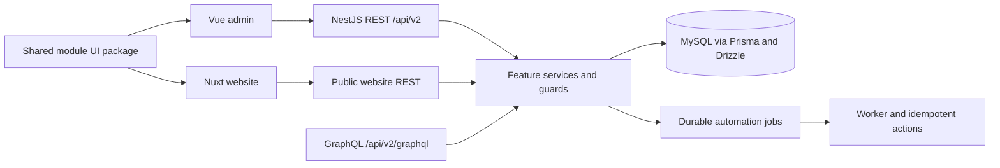

# Current architecture

Updated 2026-10-24. This describes the implemented ownership boundaries, not a
claim that all Express behavior has migrated. [Open tasks](nestjs-migration-tasks.txt)
are the source of truth for unfinished work.

## Source layout

| Location | Responsibility |
|---|---|
| `backend/lume-nestjs/src/core` | Database, permissions, runtime metadata, events, workflows and shared infrastructure |
| `backend/lume-nestjs/src/modules/<feature>` | Nest modules, REST controllers, DTOs, services and feature persistence |
| `backend/lume-nestjs/src/graphql` | GraphQL context, guards, transport adapters and schema |
| `backend/lume-nestjs/prisma` | Canonical active Prisma schema |
| `backend/lume-nestjs/migrations` | Ordered SQL migrations and runner |
| `backend/lume-nestjs/test` | Unit, HTTP and GraphQL integration regressions |
| `backend/lume-nestjs/deploy` | Service templates and operations |
| `packages/@lume/module-ui/src/modules/<feature>/static` | Shared Vue components, widgets, styles and browser API adapters |
| `apps/web-lume`, `apps/riagri-website` | Admin and public application shells |

The backend workspace package delegates normal commands to the NestJS package.
Its `legacy:*` commands and `backend/src`, `backend/prisma`, `backend/drizzle`, and
`backend/tests` remain for comparison and rollback. They are not the active schema
or the default development server. Legacy static symlinks preserve old asset paths.

The final `backend/api` move is a deployment task. Do not move the running service's
directory until its working directory, environment, build paths and rollback have
been updated. NestJS uses `@nestjs/platform-express`; that HTTP adapter is separate
from the standalone legacy Express application being retired.

## Persistence and transactions

Prisma and Drizzle operate on the same MySQL database. Shared Drizzle JSON columns
decode both text-backed JSON and driver-decoded JSON at the persistence boundary.
Use the SQL migration ledger; do not substitute legacy schema refresh scripts.
The local ledger was verified through migration 016. New environments must inspect
and apply applicable migrations rather than replaying an existing database blindly.

Sequence allocation locks its row and advances atomically. Counter edits cannot
move backwards. GraphQL `nextSequenceValue` is a mutation, not a query. REST uses
`POST /api/v2/admin/settings/sequences/:code/next`.

## Identity and access

JWT authentication is backed by persisted sessions. Controllers and resolvers
must explicitly apply their appropriate role/permission guards. Tenant-aware
record operations also enforce company scope and record/field permissions.
Approval listing filters by tenant, participant and record access; pending entries
require current-step assignment and write access. Decisions submit a step index,
and conflicting or replayed decisions fail rather than silently advancing.

## Automation and providers

The durable metadata-workflow job engine and the state-machine definition editor
are distinct contracts. Do not redirect state-machine execution to the job API
without implementing its semantics. Approval definitions support sequential user
or role steps. Delegation, escalation and other gaps remain in the task list.
External email/push/AI providers remain disabled; provider configuration is separate
from enabling internal durable workers.

## Delivery and verification

The locally deployed service is `lume-nestjs.service`. Recent migration changes
remain undeployed until release gates pass. The admin uses `VITE_API_URL`; Nuxt uses
`NUXT_PUBLIC_API_BASE` for public website APIs. Production proxying must route those
requests to NestJS without relying on an Express fallback.

See [testing](TESTING.md), [deployment](DEPLOYMENT.md), and the
[backend structure note](../backend/STRUCTURE.txt).
