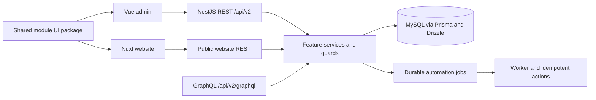

# Current architecture

Updated 2026-10-24. This describes the implemented ownership boundaries, not a
claim that all Express behavior has migrated. [Open tasks](nestjs-migration-tasks.txt)
are the source of truth for unfinished work.

## Source layout

| Location | Responsibility |
|---|---|
| `apps/api/src/core` | Database, permissions, runtime metadata, events, workflows and shared infrastructure |
| `apps/api/src/modules/<feature>` | Nest modules, REST controllers, DTOs, services and feature persistence |
| `apps/api/src/graphql` | GraphQL context, guards, transport adapters and schema |
| `apps/api/prisma` | Canonical active Prisma schema |
| `apps/api/migrations` | Ordered SQL migrations and runner |
| `apps/api/test` | Unit, HTTP and GraphQL integration regressions |
| `apps/api/deploy` | Service templates and operations |
| `packages/@lume/module-ui/src/modules/<feature>/static` | Shared Vue components, widgets, styles and browser API adapters |
| `apps/admin`, `apps/website` | Admin and public application shells |

All applications are direct workspace packages using the root pnpm lockfile.
`legacy/express`, `legacy/frontend`, the obsolete root Nuxt server and old tooling
are retained outside the workspace for feature comparison. Shared UI symlinks in
legacy modules preserve reference paths. Active apps do not import legacy code.
The service definition now uses `apps/api`; no further backend folder move is planned.
NestJS uses `@nestjs/platform-express`; its HTTP adapter is separate from the old
standalone Express application being retired.

## Persistence and transactions

Prisma and Drizzle operate on the same MySQL database. Shared Drizzle JSON columns
decode both text-backed JSON and driver-decoded JSON at the persistence boundary.
Use the SQL migration ledger; do not substitute legacy schema refresh scripts.
The local ledger was verified through migration 018, including document soft-delete
alignment and manual state execution tables. New environments must inspect
and apply applicable migrations rather than replaying an existing database blindly.

Sequence allocation locks its row and advances atomically. Counter edits cannot
move backwards. GraphQL `nextSequenceValue` is a mutation, not a query. REST uses
`POST /api/v2/admin/settings/sequences/:code/next`.

## Identity and access

JWT authentication is backed by persisted sessions. Controllers and resolvers
must explicitly apply their appropriate role/permission guards. Tenant-aware
record operations also enforce company scope and record/field permissions.
Approval listing filters by tenant, participant and record access; pending entries
require current-step assignment and write access. Decisions submit a step index,
and conflicting or replayed decisions fail rather than silently advancing.

## Automation and providers

State-machine definition validation guards activation and active edits. Updates
lock the definition row and validate the merged graph before writing; incomplete
drafts remain permitted. Manual executions use an immutable definition snapshot in
`workflow_state_executions` and ordered history in `workflow_state_history`.
The execution and record rows are locked during decisions; a version check rejects
stale requests, and state/history commit atomically. Tenant, record rules and
read/write permissions are checked on each operation. Record data is not mutated.
Advanced transition/state behavior remains unavailable; legacy history import is
still pending. See the API reference for the supported manual contract.

The durable metadata-workflow job engine and the state-machine definition editor
are distinct contracts. Do not redirect state-machine execution to the job API
without implementing its semantics. Approval definitions support sequential user
or role steps. Delegation, escalation and other gaps remain in the task list.
External email/push/AI providers remain disabled; provider configuration is separate
from enabling internal durable workers.

## Delivery and verification

The locally deployed service is `lume-nestjs.service`. The local API has restarted from its canonical directory and passed health and
GraphQL checks. Built client assets remain undeployed. The admin uses `VITE_API_URL`; Nuxt uses
`NUXT_PUBLIC_API_BASE` for public website APIs. Production proxying must route those
requests to NestJS without relying on an Express fallback.

See [testing](TESTING.md), [deployment](DEPLOYMENT.md), and the
[workspace structure](STRUCTURE.md).
